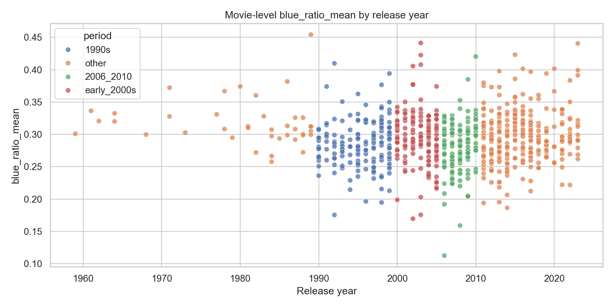
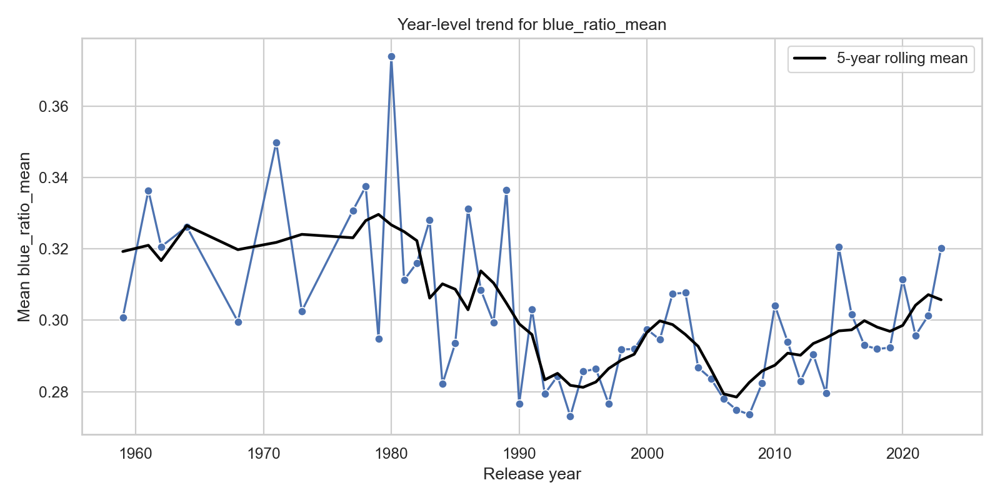
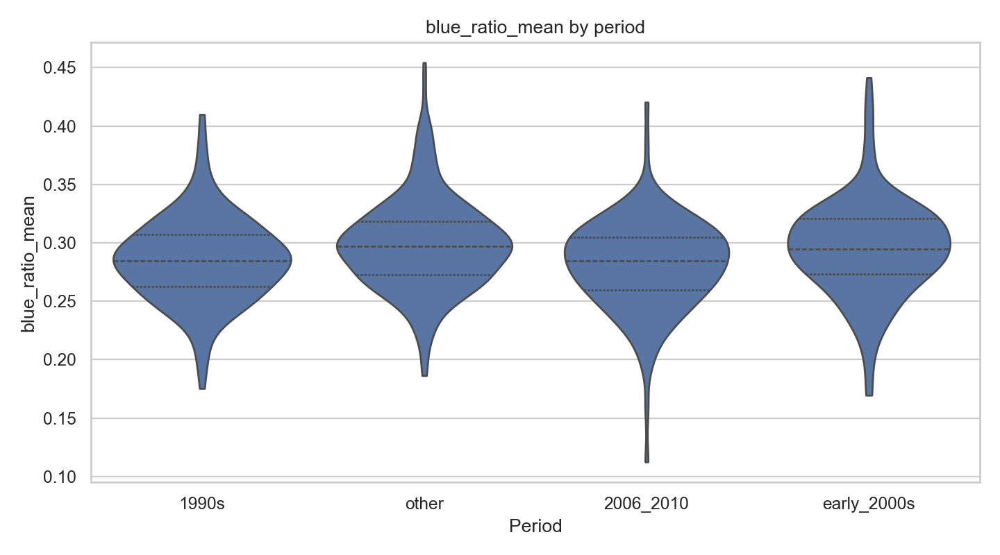
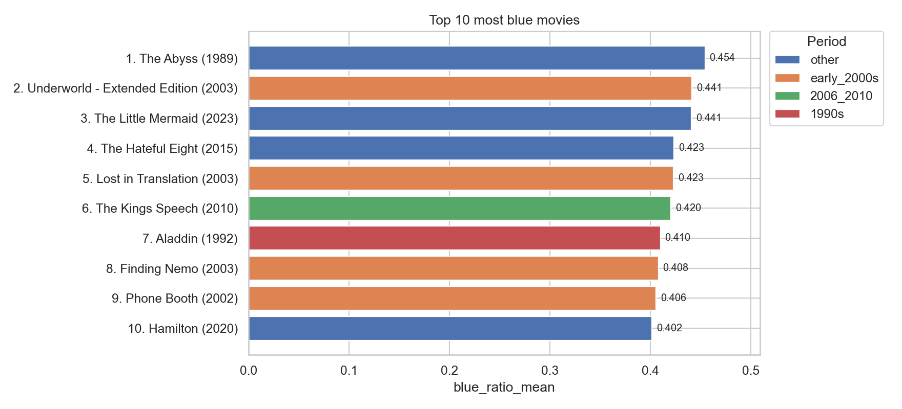
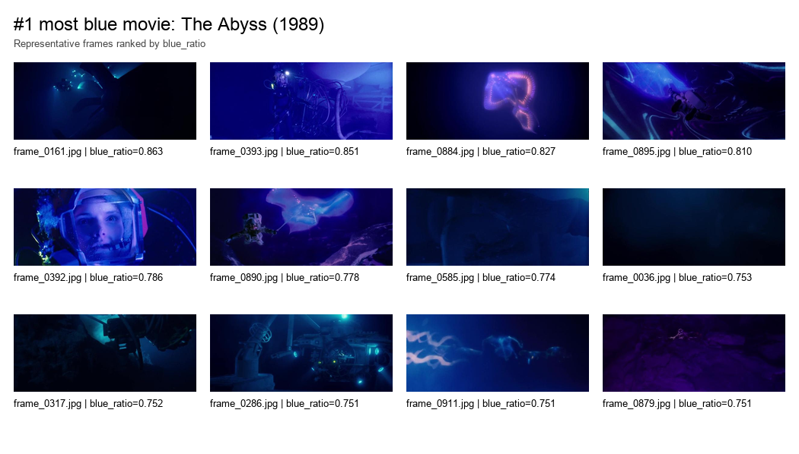
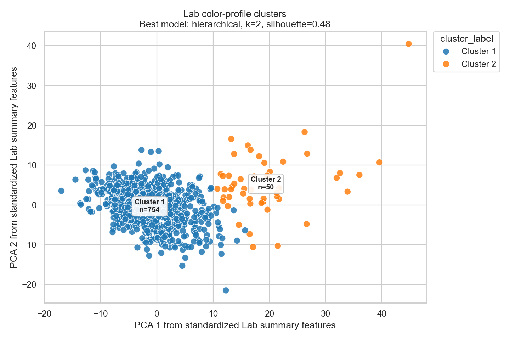
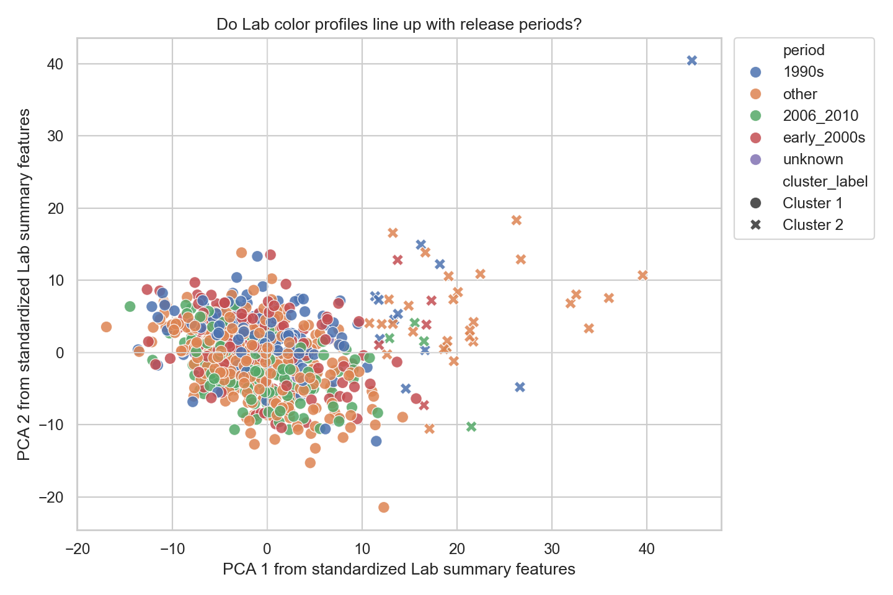
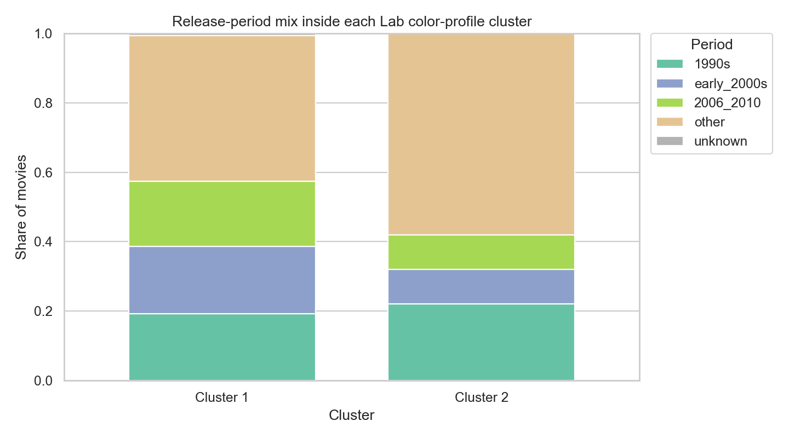
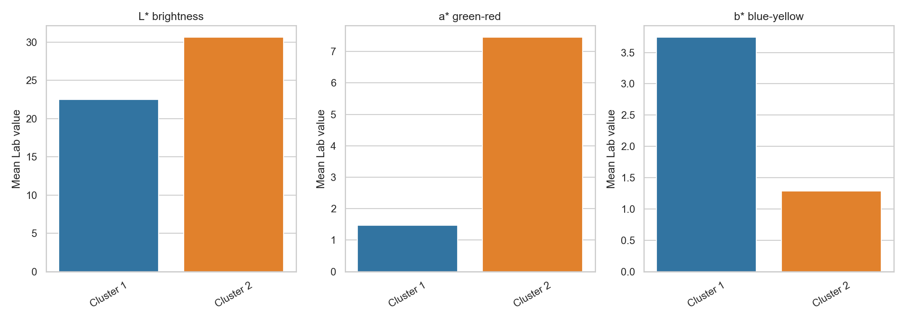



<main class="site-main project-detail" id="content">
<section class="page-intro">
Project · Color analysis
<h1>Were Movies in the Early 2000s More Blue?</h1>
A frame-level colour analysis of movies, with the movie as the unit of analysis.

PublishedUpdated 10 September 2026
</section>

<article class="prose real-post">

<figure class="article-figure article-figure--wide blue-movies-hero"><figcaption><em>The Abyss</em> (1989) is the bluest movie in this sample by the primary mean blue-ratio metric. This is one of its highest-blue frames.</figcaption></figure>

Recently I stumbled upon this question raised by <em>InternetWeakGuy</em> on Reddit: <a href="https://www.reddit.com/r/TrueFilm/comments/cx4svs/eli5_why_did_so_much_cinematography_go_blue_in/">Why did so much cinematography go blue in the early 2000s?</a> It had some interesting technical explanations, for example the rise of digital colour grading, which made adjusting a movie's palette easier and cheaper. But it still came down to a stylistic choice by the filmmaker. For anyone interested, there is an entire rabbit hole of aesthetic genre taxonomy on TikTok. The early 2000s were characterized by Digital Optimism, Cybercore, Y2K, McBling, and more.

Were movies in the early 2000s actually more blue? I wanted to test it empirically. The first step was finding a good dataset. Fortunately, I found this <a href="https://www.kaggle.com/datasets/asaniczka/movie-identification-dataset-800-movies">Movie Identification Dataset</a> on Kaggle. It contains about 1,000 frames from each of 800 movies, from the late 1980s up to the mid-2020s.

Here are three frames from the dataset:

<figure><figcaption>Jared Butler as King Leonidas in <em>300</em>.</figcaption></figure>

<figure><figcaption>Ants in <em>A Bug's Life</em>.</figcaption></figure>

<figure><figcaption>Harry, Dumbledore, and Snape in <em>Harry Potter and the Half-Blood Prince</em>.</figcaption></figure>

The plan from that point was:

<ol>
<li>Calculate how blue each frame is.</li>
<li>Average across each movie.</li>
<li>Compare the average blueness of movies from different periods.</li>
</ol>

<h2>How I Measured “Blue”</h2>

As always, there are many ways to measure the same thing. A few ideas were:

<ul>
<li>average RGB channels</li>
<li>blue ratio: <code>B / (R + G + B)</code></li>
<li>blue excess: <code>B - (R + G) / 2</code></li>
<li>share of pixels where blue is stronger than red and green</li>
<li>HSV hue-based blue pixels</li>
<li>Lab colour summaries, which separate brightness from colour direction</li>
</ul>

For simplicity, I chose <strong>Blue Ratio</strong>, calculated for each pixel's RGB channels like this:

$$
\frac{B}{R+G+B}
$$

Pixel values are averaged for each frame, and then averaged for each movie to create the main statistic in this analysis: <strong>Mean Blue Ratio</strong>.

<aside class="column-margin">In the RGB (Red, Green, Blue) pixel format, each pixel is represented with three values, or channels, indicating the intensity of each colour. Values are usually between 0 and 255, so a (120, 200, 80) RGB pixel has a medium amount of red, a high amount of green, and a low amount of blue.</aside>

<h2>The Main Movie-Level Analysis</h2>

<h3>Tests</h3>

<table>
<thead><tr><th>Metric</th><th>Comparison</th><th>Group A</th><th>Group B</th><th>n A</th><th>n B</th><th>Mean A</th><th>Mean B</th><th>Mean Difference</th><th>95% CI</th><th>Welch’s t</th><th>p-value</th></tr></thead>
<tbody>
<tr><td>Blue ratio mean</td><td>Early 2000s vs. all other</td><td>Early 2000s</td><td>All other</td><td>151</td><td>649</td><td>0.295</td><td>0.291</td><td>0.004</td><td>[-0.003, 0.011]</td><td>1.033</td><td>0.303</td></tr>
<tr><td>Blue ratio mean</td><td>Early 2000s vs. 1990s</td><td>Early 2000s</td><td>1990s</td><td>151</td><td>156</td><td>0.295</td><td>0.285</td><td>0.010</td><td>[0.001, 0.019]</td><td>2.186</td><td>0.030</td></tr>
<tr><td>Blue ratio mean</td><td>Early 2000s vs. 2006–2010</td><td>Early 2000s</td><td>2006–2010</td><td>151</td><td>147</td><td>0.295</td><td>0.281</td><td>0.014</td><td>[0.005, 0.023]</td><td>3.047</td><td>0.003</td></tr>
</tbody>
</table>

The comparison between the early 2000s (2000–2005) and the late 2000s (2006–2010) is significant, even after adjusting for multiple comparisons. The effect is not large. The many pixels and frames improve the measurement of each movie, but the movie remains the unit of analysis.

A more fine-grained regression analysis revealed no significant trends:

<figure><figcaption>Movie-level blueness by release year.</figcaption></figure>

We can see a small jump in blueness starting around the year 2000, and decreasing again later, but this is not significant.

<figure><figcaption>Smoothed blueness trend by release year.</figcaption></figure>

<h2>Comparing Periods</h2>

<figure><figcaption>Blueness by release period.</figcaption></figure>

<h2>The Bluest Movies</h2>

To make the result less abstract, I also pulled out the top movies by the primary blueness metric and a set of representative high-blue frames from the top movie.

<figure><figcaption>Top 10 most blue movies in the sample.</figcaption></figure>

<figure><figcaption>Representative frames from <em>The Abyss</em>, the most blue movie in the sample.</figcaption></figure>

<h2>A Color-Profile Sanity Check</h2>

The Lab clustering is not meant to prove the thesis. It is a sanity check.

Lab colour space gives us <em>L*</em> for lightness, <em>a*</em> for green-to-red direction, and <em>b*</em> for blue-to-yellow direction. I summarize each movie with Lab features, standardize them, cluster the movies, and then project the result into two dimensions with PCA so it can be plotted.

The question for these plots is: do movies form colour-profile groups, and do those groups map onto year or period?

<figure><figcaption>Lab colour-profile clusters.</figcaption></figure>

<figure><figcaption>The same Lab map coloured by release period.</figcaption></figure>

<figure><figcaption>Release-period mix within each Lab cluster.</figcaption></figure>

<figure><figcaption>Average Lab signature by cluster.</figcaption></figure>

If a cluster is dominated by one period, that suggests colour profile and time period are related in this sample. If the periods are mixed inside each cluster, then the “early 2000s were blue” story is probably less clean.

<h2>What I Would Not Claim</h2>

This analysis cannot prove that a release year caused a movie to be blue. There are obvious confounds: genre, source quality, restoration, compression, cinematography, animation versus live action, and which frames were sampled.

The useful version of the claim is narrower: in this dataset, using these frame samples and these colour metrics, do early-2000s movies have higher movie-level blueness than the comparison groups?

</article>



</main>


