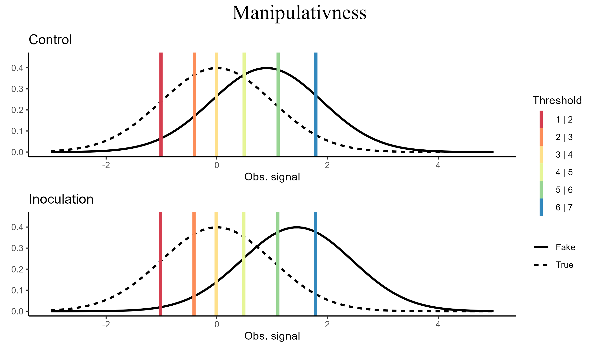
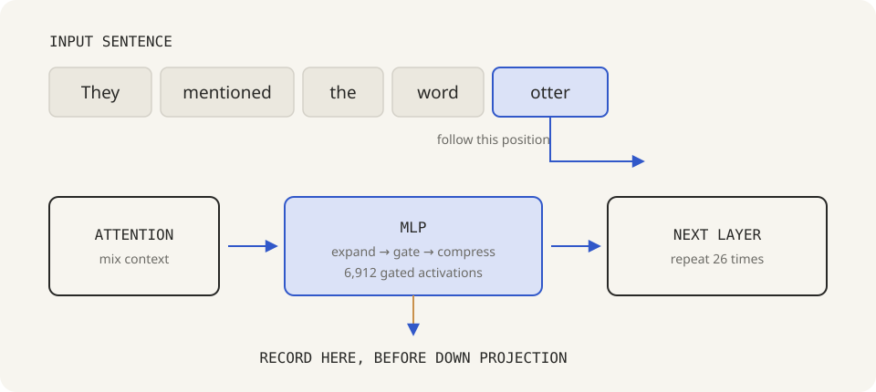
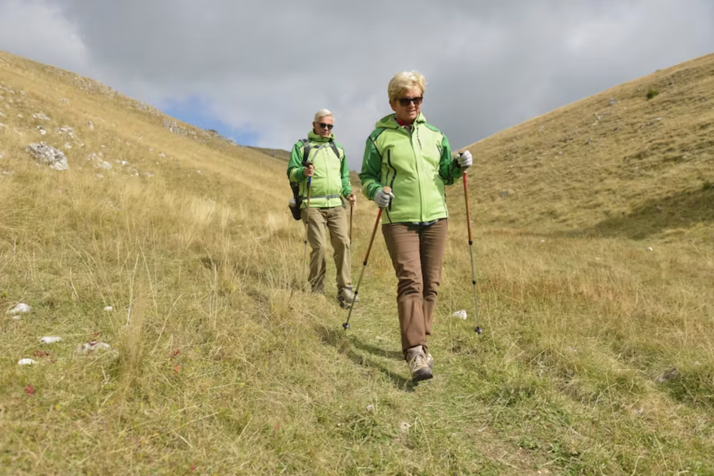



<main class="site-main" id="content">
<section class="home-hero" aria-labelledby="page-title">

ML · Model evaluation · Research tools
<h1 id="page-title">Tomer Zipori</h1>
Playful questions. Rigorous answers.

I build models, experiments, and tools to understand how people—and machines—make sense of the world.

<a class="button-link" href="#selected-work">Explore my work</a><a class="text-link" href="/assets/cv/tomer-zipori.pdf">CV</a><a class="text-link" href="#contact">Contact</a>

<iframe class="neuron-playground-frame neuron-playground-frame--home" src="/assets/neuron-playground/index.html?home=1" title="Neural Observatory preview: choose an animal or tool word and inspect its recorded activation map"></iframe>

<a class="text-link" href="/experiments/neuron-playground/">Open Neural Observatory</a> <a class="text-link" href="/posts/looking-for-an-animal-neuron/">Read the experiment</a>

</section>

<section class="section selected-work-section" id="selected-work" aria-labelledby="selected-work-title">

Selected work

<h2 id="selected-work-title">Questions with somewhere to go.</h2>
Three finished projects where a claim becomes a tool, a workflow, or a picture.

<article class="project-presentation">

01 · Visual explanation
<h3><a href="/experiments/ordinal-regression-viz/">Making ordinal models plot-able</a></h3>
Visual tools that connect model parameters to latent evidence, response thresholds, and uncertainty.

<a class="text-link" href="/experiments/ordinal-regression-viz/">Read the case study</a> <a class="text-link" href="https://github.com/tomerzipori/OrdinalRegressionViz">Repository</a>

<figure class="project-figure project-figure--ordinal"><figcaption>Evidence, criteria, response.</figcaption></figure></article>
<article class="project-presentation">

02 · Neural network investigation
<h3><a href="/posts/looking-for-an-animal-neuron/">Looking for an animal neuron</a></h3>
A controlled experiment inside Gemma that tests whether a strong animal response is really an animal concept.

<a class="text-link" href="/posts/looking-for-an-animal-neuron/">Read the experiment</a>

<figure class="project-figure"><figcaption>Follow the activation.</figcaption></figure></article>
<article class="project-presentation">

03 · Model mechanics
<h3><a href="/posts/micrograd/">What’s Artificial Intelligence all about?</a></h3>
A small hands-on path into the mechanics behind a model.

<a class="text-link" href="/posts/micrograd/">Read the article</a>

<figure class="project-figure"><figcaption>A path into model mechanics.</figcaption></figure></article>

</section>

<section class="section study-section" aria-labelledby="study-title">

Currently investigating

<h2 id="study-title">Can padding change what a model learns?</h2>
I’m testing whether padding-sensitive normalization changes audio-classification metrics in a small DistilHuBERT model. The study compares ordinary and masked normalization under two padding conditions.

<a class="button-link" href="/notes/distilhubert-padding-study/">Read the experiment note</a> Ongoing study · Pilot complete

<figure class="padding-diagram"><svg viewBox="0 0 720 190" role="img" aria-label="Two waveforms compare minimal padding and additional padding"><path class="wave-valid" d="M20 64 C42 12 63 111 85 64 S128 16 150 64 S194 112 216 64 S260 16 282 64 S326 111 348 64"/><path class="wave-valid" d="M20 140 C42 88 63 187 85 140 S128 92 150 140 S194 188 216 140 S260 92 282 140 S326 187 348 140"/><path class="wave-padding" d="M348 64 H696"/><path class="wave-padding" d="M348 140 H696"/><line x1="348" x2="348" y1="22" y2="172"/><text x="20" y="26">Minimal padding</text><text x="20" y="104">Additional padding</text><text x="367" y="26">valid audio</text><text x="555" y="26">padding</text><text x="367" y="104">valid audio</text><text x="555" y="104">padding</text></svg><figcaption>Experiment design</figcaption></figure></section>

<section class="section garden-preview-section" aria-labelledby="garden-preview-title">

Garden

<h2 id="garden-preview-title">Follow a question.</h2>
These paths connect my projects, notes, and longer articles. Pick a theme, or take an unexpected turn.



<a class="button-link" href="/garden/">Explore the full garden</a>
</section>

<section class="section contact-section" id="contact" aria-labelledby="contact-title">

About me
<h2 id="contact-title">Let’s talk about statistics, models, and deep neural networks.</h2>
My background spans psychology, experimental methods, statistics, data science, and machine learning. I'm facinated by statistics and machine learning. I explore them and turn research questions into models, visual explanations, and even sometimes tools that other people can use.

<a class="button-link" href="/about/">More about me</a> <a class="text-link" href="/assets/cv/tomer-zipori.pdf">CV</a>

<figure class="contact-portrait"></figure>
</section>
</main>


