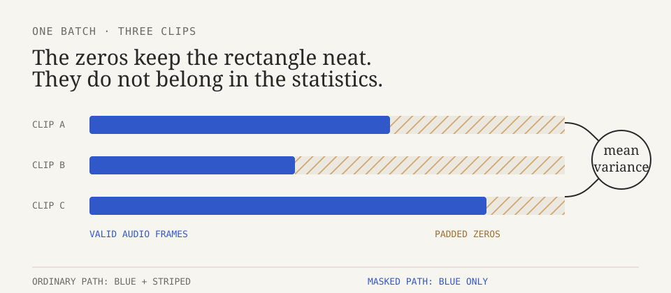
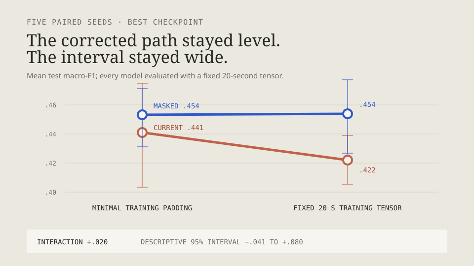



<main class="site-main" id="content">
<section class="page-intro">
Article · Models and meaning
<h1>Can gradient descent learn around padded zeros?</h1>
The bug looked obvious. Its downstream cost did not.

Experiment reportPublished 10 September 2026
</section>
<article class="prose real-post">

Start with a batch of speech recordings. One lasts two seconds. Another lasts eight. A tensor wants a rectangle, so the short recording gets six seconds of zeros.

Those zeros are bookkeeping. Then BatchNorm treats them as observations.

I found this problem in a HuBERT configuration where BatchNorm sits before the positional convolution. The layer calculates a mean and variance across the batch and time dimensions, but it does not receive the mask that says which frames are padding. More zeros change the statistics. The same valid audio can therefore produce different internal values because it shared a tensor with a different amount of padding.

That sounds like an obvious bug. In this configuration, it is: BatchNorm is meant to combine information from valid observations, not from placeholders. The problem is how the layer is used, not a universal defect in PyTorch’s BatchNorm.

But an implementation can be wrong without causing a large downstream error. Models always train in batches. If the padding pattern is stable, perhaps the model can use it. Or perhaps gradient descent can brute-force a set of weights that works around the contaminated statistics.

So I asked a narrower question: when a small speech model learns a real classification task, does a padding-aware BatchNorm produce more reliable test performance?

<figure class="article-figure article-figure--wide"><picture><source media="(max-width: 560px)" srcset="/assets/distilhubert/padding-batchnorm-mobile.svg"></picture><figcaption>BatchNorm intentionally uses a batch of valid observations. The implementation problem begins when padded positions join that batch as if they were data.</figcaption></figure>

<h2>The short answer</h2>

The correction clearly reduced padding sensitivity inside the model. It did not produce decisive evidence of a better selected-checkpoint classification score.

Across five paired seeds, ordinary BatchNorm lost some macro-F1 when training moved from minimal padding to fixed 20-second tensors. Masked BatchNorm stayed almost level. The estimated interaction was +0.020 macro-F1. Its descriptive 95% interval ran from −0.041 to +0.080.

The direction agrees with the original concern. The uncertainty also covers a small effect in the other direction, no effect, and a practically useful effect.

<figure class="article-figure article-figure--wide"><picture><source media="(max-width: 560px)" srcset="/assets/distilhubert/padding-interaction-mobile.svg"></picture><figcaption>All four models are evaluated with fixed 20-second tensors, so the x-axis changes training padding while test padding stays fixed. Error bars are descriptive 95% t intervals across five seeds.</figcaption></figure>

This is not evidence that the implementation is harmless. It is also not enough evidence to promise that fixing it improves this task.

<h2>A test for learning around the bug</h2>

I used <a href="https://huggingface.co/ntu-spml/distilhubert"><code>ntu-spml/distilhubert</code></a>, a compact pretrained HuBERT-family model, and trained a new classifier for 14 spoken intents. The data came from the Australian, British, and American English parts of <a href="https://huggingface.co/datasets/PolyAI/minds14">MInDS-14</a>: 1,809 recordings, split into 1,266 training, 269 validation, and 274 test examples.

One detail matters. The published DistilHuBERT checkpoint does not use this positional BatchNorm path. I enabled the path to create a controlled test of the reported mechanism. This experiment is about a DistilHuBERT-based configuration. It is not a claim that the original checkpoint carries the same problem.

The experiment crossed two choices:

<table><thead><tr><th>Condition</th><th>Positional normalization</th><th>Training padding</th></tr></thead><tbody><tr><td>C-L</td><td>Ordinary BatchNorm</td><td>Minimum needed in each batch</td></tr><tr><td>F-L</td><td>Masked BatchNorm</td><td>Minimum needed in each batch</td></tr><tr><td>C-H</td><td>Ordinary BatchNorm</td><td>Fixed 20-second tensor</td></tr><tr><td>F-H</td><td>Masked BatchNorm</td><td>Fixed 20-second tensor</td></tr></tbody></table>

The longest retained recording was 12 seconds. The high-padding condition extended the whole tensor to 20 seconds. It did not add 20 seconds to each recording.

The masked implementation gathered only valid feature frames, applied the same PyTorch BatchNorm to those frames, and scattered the results back into a tensor with zeros at padded positions.

Each seed used the same initialized state, examples, batch membership, batch order, optimizer, and number of updates across the four conditions. Only normalization and padding changed. The main matrix used seeds 17, 29, 43, 59, and 71, with 20 training epochs each.

Every trained model was then tested with both minimal and fixed padding. This separates a model’s training history from the padding used for one evaluation pass.

<h2>What moved inside the network</h2>

The mechanism did not disappear into measurement noise.

At the final update, changing evaluation padding shifted valid positional outputs by about 2.0 mean absolute activation units in the ordinary path. The same comparison was about 0.22 in the masked path. The exact scale is specific to this model, but the roughly nine-fold reduction shows that the mask changed the intended mechanism.

That leaves the more interesting puzzle: a clear internal correction can lead to a much less clear change at the output.

<h2>Did masking help the classifier?</h2>

Under fixed 20-second evaluation tensors, the five-seed mean best-checkpoint macro-F1 values were:

<table><thead><tr><th>Training condition</th><th>Ordinary</th><th>Masked</th></tr></thead><tbody><tr><td>Minimal padding</td><td>0.441</td><td>0.454</td></tr><tr><td>Fixed 20-second tensor</td><td>0.422</td><td>0.454</td></tr></tbody></table>

For the high-padding models, masking improved the paired mean by 0.032 macro-F1 at the selected checkpoint. Its descriptive interval was −0.007 to +0.071. That is encouraging, but it does not exclude zero.

The final epoch leaned more strongly toward the masked version: +0.049 under the same high-padding evaluation, with an interval from +0.010 to +0.088. I treat this as secondary evidence. Validation selected the best checkpoint, and that primary comparison stayed uncertain. Choosing the more convenient checkpoint after seeing the data would make the story cleaner and the evidence worse.

There is a plausible “gradient descent worked around it” story here. Ordinary BatchNorm still learned a useful classifier. Under low padding, its best matched-evaluation mean was 0.469, compared with 0.465 for masked BatchNorm. But the experiment did not observe the strategy used by gradient descent. Similar output scores do not tell us whether the model compensated, ignored the affected features, or reached the same score for another reason.

<h2>Two checks on the experiment</h2>

I repeated the seed-17 masked high-padding run. Its initialization checksum, final parameter checksum, and every reported metric matched exactly. That makes accidental nondeterminism a less convincing explanation for the pattern.

I also trained one low-padding and one high-padding control without positional BatchNorm. Under fixed 20-second evaluation, the best-checkpoint macro-F1 difference was +0.002. This control points toward the BatchNorm path, but it used one seed. It is a check, not a second five-seed experiment.

<h2>So: bug, feature, or brute force?</h2>

The padded zeros are not a useful feature of the recordings. They are a property of how the batch was assembled. Letting them change normalization statistics breaks the clean rule that adding masked padding should leave valid observations alone.

The downstream result is less dramatic. In this small model, on this intent task, masking produced a modest advantage under heavy padding, but the main five-seed interval was too wide for a firm conclusion. Gradient descent may absorb part of the problem. Model selection may absorb part of it too. This experiment cannot say how.

That is the result I wanted the study to be able to keep: the mechanism is wrong, the correction works internally, and the practical effect remains uncertain.

A semantic bug does not guarantee a large metric failure. A small metric difference does not make the semantics correct.

<h2>Limits</h2>

This was one compact model, one 14-class dataset, one training recipe, and five primary seeds. The intervals are descriptive estimates from those seeds. A larger HuBERT model, a different batching distribution, or a task that depends more on the affected positional signal could behave differently.

The public <a href="https://github.com/huggingface/transformers/issues/47739">Transformers issue</a> motivated the mechanism test. The experiment did not modify Transformers, and it does not propose a production patch.

The next useful result would not be another single lucky run. It would be a replication that changes model scale or padding distribution while preserving the same paired causal comparison.

</article>



</main>


